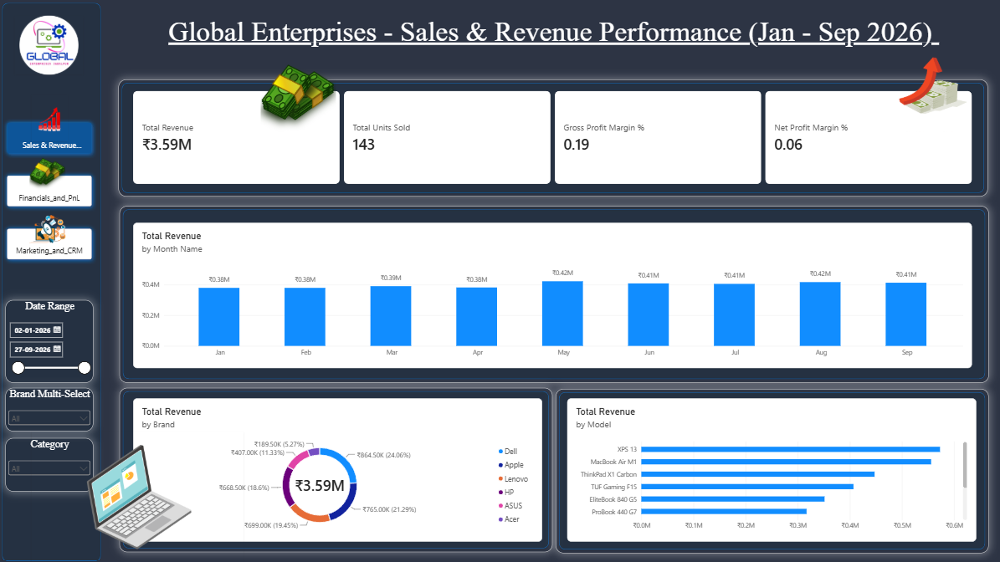
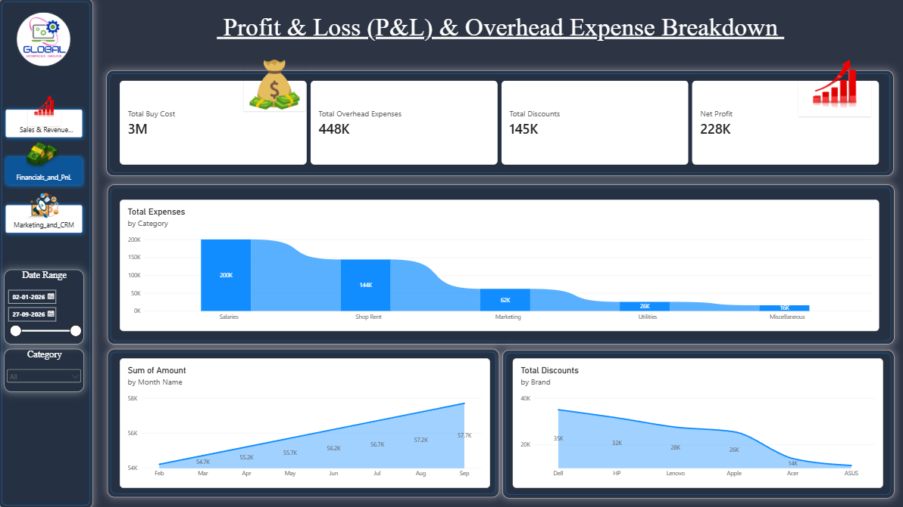
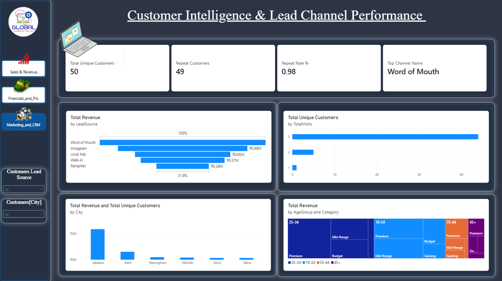

# 💻 Global Enterprises — Sales, Financials & Customer Intelligence Analysis (Power BI)


An end-to-end Power BI analytics project for **Global Enterprises** (a second-hand laptop reseller based in Jabalpur) covering sales revenue, profitability (P&L), overhead expenses, and customer CRM acquisition channels from **January 2026 to September 2026**.

---

## 📂 Repository Folder Structure

```text
global-enterprises-powerbi-analysis/
│
├── screenshots/                                     # Dashboard screenshots
│   ├── Sales.png
│   ├── Profit.png
│   └── Customers.png
│
├── data/
│   └── raw/                                         # Raw datasets
│       ├── Sales_Transactions.csv
│       ├── Inventory_Buy_Costs.csv
│       ├── Overhead_Expenses.csv
│       └── Customer_CRM.csv
│
├── pbix/
│   └── Global_Enterprises_Dashboard.pbix
│
├── .gitignore
├── LICENSE                                          # MIT
└── README.md
```

---

## 📸 Dashboard Preview

### 1. Sales & Revenue Performance


### 2. Profit & Loss (P&L) & Overhead Expense Breakdown


### 3. Customer Intelligence & Lead Channel Performance


---

## 📊 Data Model Pattern & Architecture

The project uses a **Star Schema (Dimensional Model)** in Power BI for optimal DAX performance and clean cross-filtering across report pages.

```text
                     +---------------------------+
                     |    Dim_Calendar (Date)    |
                     +---------------------------+
                                   | 1
                                   |
                                   | *
+--------------------+ 1         * +---------------------------+ *         1 +-----------------------+
|    Dim_Customers   |-----------|        Fact_Sales         |-----------|      Dim_Laptops      |
+--------------------+           +---------------------------+           +-----------------------+
                                   | *
                                   |
                                   | 1
                     +---------------------------+
                     |    Fact_Expenses (P&L)    |
                     +---------------------------+
```

### Fact Tables
- **Fact_Sales** — transactional measures (Line Revenue, Buy Cost, Discount Amount, Quantity)
- **Fact_Expenses** — monthly operating overheads (Rent, Salaries, Marketing, Utilities, Misc)

### Dimension Tables
- **Dim_Customers** — demographics (AgeGroup, City, LeadSource, TotalVisits)
- **Dim_Laptops** — hardware catalog (Brand, Model, Category: Budget, Mid-Range, Premium, Gaming)
- **Dim_Calendar** — single date dimension for time-intelligence DAX

---

## 📁 Raw Data Schemas

### 1. `Sales_Transactions.csv`
| Column | Type | Description |
|---|---|---|
| TransactionID | Text | Unique identifier for each sale |
| Date | Date | Sale date (DD/MM/YYYY) |
| CustomerID | Text | FK to Customer CRM table |
| LaptopID | Text | FK to Laptops catalog |
| Line Revenue | Decimal | Final selling price realized (₹) |
| Discount Amount | Decimal | Total discount provided (₹) |

### 2. `Inventory_Buy_Costs.csv`
| Column | Type | Description |
|---|---|---|
| LaptopID | Text | Unique laptop SKU ID |
| Brand | Text | Dell, Apple, Lenovo, HP, ASUS, Acer |
| Model | Text | e.g., XPS 13, MacBook Air M1, ThinkPad X1 Carbon |
| Buy Cost | Decimal | Acquisition/refurbishment cost (₹) |

### 3. `Overhead_Expenses.csv`
| Column | Type | Description |
|---|---|---|
| ExpenseID | Text | Unique expense entry ID |
| Date | Date | Transaction date |
| Expense Category | Text | Salaries, Shop Rent, Marketing, Utilities, Miscellaneous |
| Amount | Decimal | Expense amount in INR (₹) |

### 4. `Customer_CRM.csv`
| Column | Type | Description |
|---|---|---|
| CustomerID | Text | Primary Key |
| City | Text | Jabalpur, Katni, Narsinghpur, Mandla, Seoni, Satna |
| LeadSource | Text | Word of Mouth, Instagram, Local Ads, Walk-in, Pamphlet |
| AgeGroup | Text | 18-24, 25-34, 35-44, 45+ |
| TotalVisits | Integer | Number of store visits / orders |

---

## 🧹 Data Cleaning & Transformation (Power Query ETL)

Before modelling, the raw datasets went through the following ETL steps in Power Query:

**Schema Standardization & Data Types**
- Standardized all monetary values (Line Revenue, Buy Cost, Discount Amount, Expense Amount) to Currency (INR ₹)
- Converted purchase and customer dates to standard Date format (DD/MM/YYYY) and trimmed padded whitespace

**Handling Missing & Invalid Values**
- Imputed null City values with a default regional assumption (Jabalpur)
- Filtered out canceled transactions and invalid zero-revenue rows

**Custom Column Engineering**
- **Age Group Categorization:** binned customers into 18-24, 25-34, 35-44, 45+
- **Laptop Category Hierarchy:** classified models into Budget, Mid-Range, Premium, Gaming
- **Date Dimension:** generated a Calendar table (Year, Month Name, Month Number, Quarter)

**Deduplication & Relationship Normalization**
- Removed duplicate customer records and calculated distinct Total Unique Customers (50) vs Repeat Customers (49)

---

## 📐 Key DAX Calculations & Measures

```dax
// Total Revenue
Total Revenue = SUM(Sales[Line Revenue])

// Total Units Sold
Total Units Sold = COUNT(Sales[TransactionID])

// Gross Profit Margin %
Gross Profit Margin % =
DIVIDE([Total Revenue] - [Total Buy Cost], [Total Revenue], 0)

// Net Profit
Net Profit = [Total Revenue] - [Total Buy Cost] - [Total Overhead Expenses]

// Net Profit Margin %
Net Profit Margin % =
DIVIDE([Net Profit], [Total Revenue], 0)

// Repeat Customer Rate %
Repeat Rate % =
DIVIDE(
    COUNTROWS(FILTER(Customers, Customers[TotalVisits] > 1)),
    COUNTROWS(Customers),
    0
)
```

---

## 📌 Executive Summary & Key KPIs

| Key Metric | Value | Description |
|---|---|---|
| Total Revenue | ₹3.59M | Aggregate revenue across all sales channels |
| Total Units Sold | 143 Units | Total refurbished laptop units sold |
| Gross Profit Margin | 19.0% | Margin after product buy costs |
| Net Profit Margin | 6.0% | Bottom-line margin after operating expenses |
| Total Buy Cost | ₹3.00M | Procurement and refurbishment inventory cost |
| Total Overhead Expenses | ₹448K | Shop rent, salaries, marketing, and utilities |
| Net Profit | ₹228K | Total net earnings after all expenses |
| Total Unique Customers | 50 | Total distinct buyers onboarded |
| Repeat Customer Rate | 98.0% | Share of customers with more than one visit |
| Top Acquisition Channel | Word of Mouth | Leading organic lead source for revenue |

---

## 💡 Key Business Insights

**Sales & Brand Performance**
- Dell leads revenue share at **24.06% (₹864.50K)**, followed by Apple (21.29% / ₹765.00K) and Lenovo (19.45% / ₹699.00K)
- Top-selling flagship models: Dell XPS 13, MacBook Air M1, Lenovo ThinkPad X1 Carbon

**Financials & Expense Distribution**
- Salaries (₹200K) and Shop Rent (₹144K) make up over **76.7%** of total overhead expenses (₹448K)
- Total discounts offered reached ₹145K, with Dell and HP receiving the highest absolute discounts

**Demographics & Lead Channels**
- Word of Mouth is the primary driver of high-value conversions (₹0.88M revenue), followed by Instagram and Local Ads
- Jabalpur is the central revenue hub; 25–34 year-olds buying Mid-Range and Premium laptops form the largest revenue segment

---

## 🛠️ How to Run / Open This Project

1. Clone this repository:
   ```bash
   git clone https://github.com/your-username/global-enterprises-powerbi-analysis.git
   ```
2. Open **Microsoft Power BI Desktop**.
3. Open the file `pbix/Global_Enterprises_Dashboard.pbix`.
4. *(Optional)* Re-link data source paths to the `data/raw/` folder if prompted.

---

## ✒️ Author & Contact

- **Developer:** Shreyansh Burman
- **Role:** Data Analyst / BI Developer
- **Tools Used:** Power BI Desktop, DAX, Power Query, Excel/CSV
